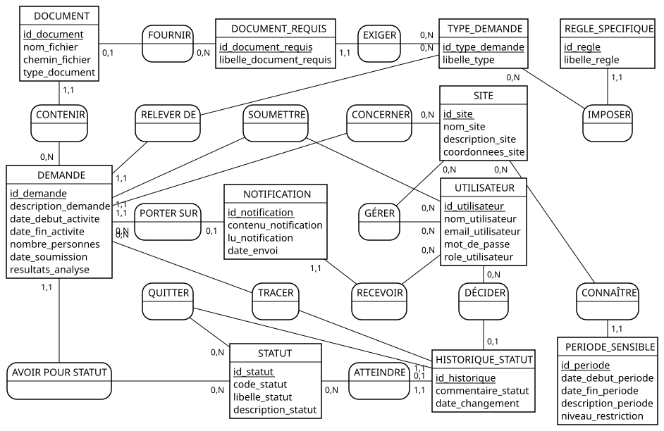

# Conception de la base de données

Plateforme d'accès aux aires protégées — Association FANAMBY

Ce document suit la démarche de [Demarche_conception_bdd.docx](Demarche_conception_bdd.docx). On y descend du sens (les besoins, le MCD) vers la technique (le MLD, le MPD), une étape après l'autre :

| # | Étape | Livrable |
|---|---|---|
| 1 | Analyse des besoins | Règles de gestion RG01 à RG14 et dictionnaire des données : [Etape1_Analyse_Besoins.md](../1_Gestion_Projet/Etape1_Analyse_Besoins.md) |
| 2 | Modèle conceptuel (MCD) | [MCD.svg](MCD.svg), source [mcd.mcd](mcd.mcd) et [section 2](#2-modèle-conceptuel-mcd) |
| 3 | Modèle logique (MLD) | [Section 3](#3-modèle-logique-mld) |
| 4 | Normalisation | [Section 4](#4-normalisation) |
| 5 | Modèle physique (MPD) | [base_de_donnees.sql](base_de_donnees.sql), [schema.dbml](../3_Application/database/schema.dbml) et [section 5](#5-modèle-physique-mpd) |
| — | Dénormalisation maîtrisée | [Section 6](#6-dénormalisation-maîtrisée) |

---

## 1. Analyse des besoins

Les règles de gestion et le dictionnaire des données sont dans [Etape1_Analyse_Besoins.md](../1_Gestion_Projet/Etape1_Analyse_Besoins.md). Les règles qui fixent le plus la structure sont rappelées ici :

- **RG04** : un validateur gère zéro à plusieurs sites, et un site peut avoir zéro à plusieurs validateurs. C'est une association plusieurs-à-plusieurs.
- **RG06** : un type de demande exige plusieurs pièces et impose plusieurs règles. Ce sont des listes : chacune devient une entité.
- **RG09** : chaque changement de statut est conservé, avec son auteur et sa date. L'historique est donc une entité à part entière, pas un simple attribut de la demande.
- **RG13** et **RG14** : ce sont des contraintes d'intégrité (dates cohérentes, effectif d'au moins une personne, traces à conserver). On les retrouve à l'étape 5 sous forme de CHECK et de RESTRICT.

## 2. Modèle conceptuel (MCD)

Le diagramme suit la notation Merise. Il est généré avec [Mocodo](https://www.mocodo.net) à partir de [mcd.mcd](mcd.mcd) : pour le modifier, on colle ce fichier sur mocodo.net. Les identifiants sont soulignés, et les cardinalités se lisent du côté de l'entité concernée.

### Entités

Les attributs sont ceux du dictionnaire des données.

| Entité | Identifiant | Attributs |
|---|---|---|
| UTILISATEUR | id_utilisateur | nom_utilisateur, email_utilisateur, mot_de_passe, role_utilisateur, organisation_utilisateur, fonction_utilisateur, adresse_utilisateur, telephone_utilisateur, piece_identite |
| SITE | id_site | nom_site, description_site, coordonnees_site |
| STATUT | id_statut | code_statut, libelle_statut, description_statut |
| TYPE_DEMANDE | id_type_demande | libelle_type, precision_requise |
| DOCUMENT_REQUIS | id_document_requis | libelle_document_requis |
| REGLE_SPECIFIQUE | id_regle | libelle_regle |
| DEMANDE | id_demande | titre_projet, precision_type, description_demande, objectifs_projet, date_debut_activite, date_fin_activite, nombre_personnes, date_soumission, resultats_analyse |
| DOCUMENT | id_document | nom_fichier, chemin_fichier, type_document |
| HISTORIQUE_STATUT | id_historique | commentaire_statut, date_changement |
| PERIODE_SENSIBLE | id_periode | date_debut_periode, date_fin_periode, description_periode, niveau_restriction |
| NOTIFICATION | id_notification | contenu_notification, lu_notification, date_envoi |

### Associations et cardinalités

| Association | Entité A (card.) | Entité B (card.) | Lecture | Règle |
|---|---|---|---|---|
| GÉRER | UTILISATEUR (0,n) | SITE (0,n) | Un validateur gère zéro à plusieurs sites ; un site a zéro à plusieurs validateurs | RG04 |
| SOUMETTRE | UTILISATEUR (0,n) | DEMANDE (1,1) | Une demande est soumise par un et un seul utilisateur | RG02 |
| CONCERNER | SITE (0,n) | DEMANDE (1,1) | Une demande concerne un et un seul site | RG03 |
| RELEVER DE | TYPE_DEMANDE (0,n) | DEMANDE (1,1) | Une demande relève d'un et un seul type | RG05 |
| AVOIR POUR STATUT | STATUT (0,n) | DEMANDE (1,1) | Une demande a un et un seul statut courant | RG07 |
| EXIGER | TYPE_DEMANDE (0,n) | DOCUMENT_REQUIS (1,1) | Une pièce requise appartient à un seul type | RG06 |
| IMPOSER | TYPE_DEMANDE (0,n) | REGLE_SPECIFIQUE (1,1) | Une règle appartient à un seul type | RG06 |
| CONTENIR | DEMANDE (0,n) | DOCUMENT (1,1) | Un document appartient à une seule demande | RG10 |
| FOURNIR | DOCUMENT_REQUIS (0,n) | DOCUMENT (0,1) | Un document fournit au plus une pièce requise | RG10 |
| TRACER | DEMANDE (0,n) | HISTORIQUE_STATUT (1,1) | Une entrée d'historique porte sur une seule demande | RG09 |
| DÉCIDER | UTILISATEUR (0,n) | HISTORIQUE_STATUT (0,1) | Une entrée a au plus un auteur (aucun si son compte a été supprimé) | RG09 |
| QUITTER | STATUT (0,n) | HISTORIQUE_STATUT (0,1) | Ancien statut : absent pour une demande soumise directement | RG09 |
| ATTEINDRE | STATUT (0,n) | HISTORIQUE_STATUT (1,1) | Nouveau statut : toujours présent | RG09 |
| CONNAÎTRE | SITE (0,n) | PERIODE_SENSIBLE (1,1) | Une période sensible concerne un seul site | RG11 |
| RECEVOIR | UTILISATEUR (0,n) | NOTIFICATION (1,1) | Une notification est adressée à un seul utilisateur | RG12 |
| PORTER SUR | DEMANDE (0,n) | NOTIFICATION (0,1) | Une notification concerne au plus une demande | RG12 |

### Choix de modélisation

- **HISTORIQUE_STATUT est une entité, pas une association.** Une même demande peut passer plusieurs fois par le même statut, par exemple en_analyse → a_completer → en_analyse. Une association ternaire DEMANDE–STATUT–UTILISATEUR interdirait ces répétitions, car son identifiant serait le triplet. L'entité a donc son propre identifiant.
- **DOCUMENT_REQUIS et REGLE_SPECIFIQUE sont des entités.** Ce sont des listes, et une liste rangée dans un seul attribut violerait la 1NF (voir la section 4). DOCUMENT_REQUIS est en plus référencé par DOCUMENT : c'est ce qui permet de savoir quelle pièce un fichier fournit.
- **AVOIR POUR STATUT double l'information portée par l'historique.** RG07 demande un statut courant, et c'est aussi celui de la dernière entrée de l'historique. Ce doublon est assumé : il est traité comme une dénormalisation (section 6).

## 3. Modèle logique (MLD)

On applique les règles de passage du cours :

1. Chaque entité devient une table, et son identifiant devient la clé primaire.
2. Une association avec une cardinalité (1,1) ou (0,1) d'un côté devient une clé étrangère de ce côté. Avec (0,1), la clé étrangère peut être vide.
3. L'association plusieurs-à-plusieurs GÉRER devient une table d'association, `t_site_user`, dont la clé primaire combine les deux clés étrangères.

Les noms sont ceux du schéma réel. **Convention de nommage** : chaque table porte le préfixe `t_` (table), suivi du nom de l'entité au pluriel ; les noms d'index et de contraintes reprennent le nom de la table (`t_demandes_user_id_foreign`, `chk_t_demandes_dates`). La clé primaire est soulignée, et le symbole # marque une clé étrangère ; un (*) signale une clé étrangère qui peut être vide.

- **t_users** (<u>id</u>, name, email, password, role, organisation, fonction, adresse, telephone, piece_identite, …)
- **t_sites** (<u>id</u>, nom, description, polygone_coordonnees)
- **t_site_user** (<u>#user_id, #site_id</u>)
- **t_statuts** (<u>id</u>, code, libelle, description)
- **t_type_demandes** (<u>id</u>, libelle, precision_requise)
- **t_documents_requis** (<u>id</u>, #type_demande_id, libelle, reutilisable)
- **t_regles_specifiques** (<u>id</u>, #type_demande_id, libelle)
- **t_demandes** (<u>id</u>, #user_id, #site_id, #type_demande_id, #statut_id, titre, type_precision, description, objectifs, date_debut, date_fin, equipe_nombre, date_soumission, resultats_analyse)
- **t_documents** (<u>id</u>, #demande_id, #document_requis_id (*), nom_fichier, chemin, type_document)
- **t_historique_statuts** (<u>id</u>, #demande_id, #user_id (*), #ancien_statut_id (*), #nouveau_statut_id, commentaire, date_changement)
- **t_periode_sensibles** (<u>id</u>, #site_id, date_debut, date_fin, description, niveau_restriction)
- **t_notifications** (<u>id</u>, #user_id, #demande_id (*), contenu, lu, date_envoi)

On obtient 12 tables : 11 entités, plus la table d'association `t_site_user`. Les quatre clés étrangères facultatives viennent des quatre cardinalités (0,1) du MCD : FOURNIR, DÉCIDER, QUITTER et PORTER SUR.

Trois tables ont été ajoutées avec les fonctionnalités suivantes (documents officiels relus avant la validation, page Références). Elles ne figurent pas encore dans le MCD :

- **t_documents_officiels** (<u>id</u>, #demande_id, #genere_par (*), type, contenu) — un document de chaque type par demande (UNIQUE `demande_id, type`)
- **t_documents_reference** (<u>id</u>, #user_id (*), titre, description, nom_fichier, chemin, type_mime, taille)
- **t_modeles_reference** (<u>id</u>, titre, description, usage, icone, automatique, contenu) — titre unique

La base compte donc 15 tables métier.

## 4. Normalisation

### Première forme normale (1NF)

Chaque cellule doit contenir une seule valeur. Le schéma compte quatre colonnes JSON, examinées une par une :

| Colonne | Verdict | Raison |
|---|---|---|
| `t_type_demandes.documents_requis` (ancienne) | ❌ Violait la 1NF → **corrigée** | Une liste de pièces dans une seule cellule, comme le contre-exemple « cours_suivis = INF101, MAT202 » du cours. La pièce jointe ne pouvait s'y rattacher que par son libellé : renommer une pièce faisait perdre les fichiers déjà déposés. Elle est remplacée par la table `t_documents_requis`, référencée par `t_documents.document_requis_id`. |
| `t_type_demandes.regles_specifiques` (ancienne) | ❌ Violait la 1NF → **corrigée** | Une liste de règles dans une seule cellule. Elle est remplacée par la table `t_regles_specifiques`. |
| `t_sites.polygone_coordonnees` | ✅ Conforme | Un contour géographique est **une seule valeur** : il n'a de sens qu'en entier. On ne cherche jamais un sommet isolé. C'est l'équivalent d'un type géométrique, que MySQL propose aussi (`POLYGON`). |
| `t_demandes.resultats_analyse` | ✅ Assumée | C'est la photographie, prise à la soumission, du rapport du moteur d'analyse. Elle est toujours lue en entier et ne doit jamais être recalculée. C'est une dénormalisation volontaire (section 6). |

La structure corrigée est créée directement par [2026_10_19_200003_create_t_type_demandes_table.php](../3_Application/database/migrations/2026_10_19_200003_create_t_type_demandes_table.php) : la migration de correction d'origine, qui reprenait les données existantes, a été fondue dans le schéma lors de la réécriture des migrations. Le comportement est vérifié par le test [ConceptionBddTest.php](../3_Application/tests/Feature/ConceptionBddTest.php).

### Deuxième forme normale (2NF)

La 2NF ne peut être violée que par une table à clé primaire composée. Il n'y en a qu'une, `t_site_user` (user_id, site_id), et elle n'a aucun autre attribut. Toutes les autres tables ont une clé primaire simple. **Le schéma est en 2NF.**

### Troisième forme normale (3NF)

On a cherché, table par table, un attribut non-clé qui dépendrait d'un autre attribut non-clé :

- `t_demandes` : titre, précision du type, synopsis (description), objectifs, dates, effectif, date de soumission et analyse dépendent tous de la demande. Le site, le type et l'auteur sont des clés étrangères, et leurs propres attributs (nom du site, libellé du type…) restent dans leurs tables.
- `t_notifications` : `user_id` ne se déduit pas de `demande_id`, car le destinataire peut être le demandeur, un validateur du site ou un administrateur.
- `t_historique_statuts` : l'auteur, les statuts et la date décrivent un événement, et non la demande.
- `t_documents` : `type_document` dépend de `document_requis_id`, ce qui est une dépendance transitive. Elle est **volontaire** : le libellé est figé au jour du dépôt (section 6).
- `t_documents_requis` a deux clés candidates, `id` et (`type_demande_id`, `libelle`), toutes deux protégées par une contrainte. La table est donc aussi en forme de Boyce-Codd (BCNF).

**Le schéma est en 3NF.** Les seules redondances sont les trois dénormalisations décrites en section 6.

## 5. Modèle physique (MPD)

- **SGBD** : MySQL 8.0.16+ ou MariaDB 10.2+ (InnoDB, utf8mb4).
- **Source de vérité** : les migrations Laravel de [database/migrations/](../3_Application/database/migrations/), une par table (ou groupe de tables liées), qui créent directement l'état final avec ses contraintes.
- **Nommage** : préfixe `t_` sur **toutes** les tables, y compris les tables techniques de Laravel (`t_sessions`, `t_cache`, `t_cache_locks`, `t_jobs`, `t_job_batches`, `t_failed_jobs`, `t_password_reset_tokens`, `t_migrations`), déclarées dans la configuration de l'application.
- **Script lisible** : [base_de_donnees.sql](base_de_donnees.sql). Il a été vérifié identique à la base migrée : mêmes colonnes, types, valeurs par défaut, clés, CHECK et index.
- **Diagramme** : [schema.dbml](../3_Application/database/schema.dbml), à coller sur dbdiagram.io.

### Correspondance dictionnaire → colonnes

Le framework impose quelques noms anglais pour les comptes. Les autres noms reprennent ceux du dictionnaire, sans le suffixe de l'entité :

| Dictionnaire | Colonne |
|---|---|
| id_utilisateur, nom_utilisateur, email_utilisateur, mot_de_passe, role_utilisateur | t_users.id, name, email, password, role |
| organisation_utilisateur, fonction_utilisateur, adresse_utilisateur, telephone_utilisateur, piece_identite | t_users.organisation, fonction, adresse, telephone, piece_identite |
| nom_site, description_site, coordonnees_site | t_sites.nom, description, polygone_coordonnees |
| libelle_type, precision_requise | t_type_demandes.libelle, precision_requise |
| titre_projet, precision_type, description_demande, objectifs_projet, date_debut_activite, date_fin_activite, nombre_personnes | t_demandes.titre, type_precision, description, objectifs, date_debut, date_fin, equipe_nombre |
| code_statut, libelle_statut, description_statut | t_statuts.code, libelle, description |
| libelle_document_requis / libelle_regle | t_documents_requis.libelle / t_regles_specifiques.libelle |
| chemin_fichier | t_documents.chemin |
| commentaire_statut | t_historique_statuts.commentaire |
| date_debut_periode, date_fin_periode, description_periode | t_periode_sensibles.date_debut, date_fin, description |
| contenu_notification, lu_notification | t_notifications.contenu, lu |

### Types

- Identifiants : `BIGINT UNSIGNED AUTO_INCREMENT`.
- Textes courts : `VARCHAR(n)`, la longueur dépendant de l'usage (50 pour un code, 150 pour un nom de site ou de pièce, 255 pour une règle).
- Textes longs : `TEXT`.
- Dates : `DATE` pour les jours, `TIMESTAMP` pour les instants.
- Listes fermées : `ENUM` pour le rôle et le niveau de restriction.
- Booléen : `TINYINT(1)`.
- Documents structurés lus en entier : `JSON`.

### Contraintes d'intégrité

| Contrainte | Où | Règle |
|---|---|---|
| Clés primaires | Toutes les tables ; composée pour `t_site_user` | — |
| UNIQUE | `t_users.email`, `t_statuts.code`, `t_documents_requis (type_demande_id, libelle)` | RG01, RG08, RG06 |
| NOT NULL | Tout attribut obligatoire. Les dates d'une demande restent facultatives tant qu'elle est un brouillon. | — |
| CHECK `date_fin >= date_debut` | `t_demandes`, `t_periode_sensibles` | RG13 |
| CHECK `equipe_nombre >= 1` | `t_demandes` | RG13 |
| ENUM | `t_users.role`, `t_periode_sensibles.niveau_restriction` | RG01, RG11 |

Les règles de suppression découlent du sens de chaque lien :

| Clé étrangère | ON DELETE | Pourquoi |
|---|---|---|
| t_demandes → t_sites, t_type_demandes, t_statuts | **RESTRICT** | Une demande et son historique sont des traces : supprimer un site ou un type ne doit pas les effacer (RG14). L'interface explique le refus. |
| t_demandes → t_users | CASCADE | Supprimer son compte efface ses propres demandes. Ses décisions sur les dossiers des autres restent. |
| t_historique_statuts → t_users | SET NULL | La décision reste, sans auteur (RG09). |
| t_documents → t_documents_requis | SET NULL | Retirer une pièce d'un type ne supprime pas les fichiers des dossiers déjà déposés. |
| t_documents, t_historique_statuts, t_notifications → t_demandes ; t_documents_requis, t_regles_specifiques → t_type_demandes ; t_periode_sensibles, t_site_user → t_sites | CASCADE | Ces lignes n'existent que par leur parent. |

Chaque contrainte est déclarée dans la migration de sa table, par exemple [2026_10_19_200004_create_t_demandes_table.php](../3_Application/database/migrations/2026_10_19_200004_create_t_demandes_table.php) pour les RESTRICT et les CHECK de `t_demandes`. La base applique ces contraintes quel que soit le code qui l'appelle, et des tests vérifient qu'elle refuse les données invalides.

### Index

- InnoDB indexe automatiquement chaque clé étrangère, donc les jointures et les filtres par demandeur, site, type ou statut sont couverts.
- Index composite `t_notifications (user_id, lu, date_envoi)` : la cloche lit à **chaque page** les notifications non lues de l'utilisateur, triées par date. Cet index répond à la requête sans parcourir la table. Il sert aussi d'index à la clé étrangère `user_id`.

## 6. Dénormalisation maîtrisée

Le schéma contient trois redondances. Chacune répond à un besoin réel, et la cohérence de chaque copie est garantie.

### 6.1 `t_demandes.resultats_analyse` — figer une valeur dans le temps

C'est le cas du `prix_unitaire` dans le cours. À la soumission, le moteur d'analyse compare les dates aux périodes sensibles du site, et ses alertes sont copiées dans la demande. Si une période est modifiée l'année suivante, la demande garde l'analyse sur laquelle la décision a été prise. Recalculer cette analyse donnerait un résultat **faux** pour une demande passée. Cette copie est donc une nécessité métier.

### 6.2 `t_documents.type_document` — libellé figé au dépôt

Même logique. La pièce jointe est reliée par clé étrangère à la pièce requise qu'elle fournit (`document_requis_id`), mais elle garde le libellé tel qu'il était au jour du dépôt. Si l'administration renomme ou retire la pièce plus tard, le dossier montre toujours ce qui a été réellement déposé.

### 6.3 `t_demandes.statut_id` — statut courant

- **Le besoin** : le statut courant est lu partout : listes, filtres et compteurs par statut, tableaux de bord, contrôles d'accès. Le retrouver dans `t_historique_statuts` demanderait, pour chaque demande, de chercher la dernière entrée de l'historique. C'est une sous-requête corrélée répétée sur chaque ligne, comme le `COUNT(*)` répété du cours (exemple 3).
- **L'invariant** : `statut_id` est le `nouveau_statut_id` de la dernière entrée de l'historique, ou « brouillon » si la demande n'a pas encore d'historique.
- **La cohérence** est garantie par la logique applicative. Chaque changement de statut, y compris la soumission, met à jour la demande et ajoute l'entrée d'historique **dans la même transaction**, sous verrou sur la demande. On le voit dans `DemandeController::historiser` et dans `Validateur\DemandeController::updateStatut`.
- **Le rattrapage** : les soumissions antérieures à cette règle avaient été historisées par une migration de reprise, devenue inutile depuis la réécriture des migrations (la base repart vide) ; le jeu de test [donnees_test.sql](../3_Application/database/donnees_test.sql) historise lui aussi chaque soumission. Une requête de contrôle sur les 22 demandes du jeu de test confirme l'invariant (0 écart).

## 7. Conformité aux bonnes pratiques de la démarche

| Bonne pratique | Application |
|---|---|
| Ne pas sauter d'étape | Les cinq livrables existent et renvoient les uns aux autres (tableau en tête de ce document). |
| Valider les règles de gestion | RG01–RG14 décrivent le comportement réel de l'application : RG04 tient compte des sites sans validateur, RG09 de la soumission et des comptes supprimés. |
| Soigner les cardinalités | Elles figurent dans le MCD, et chaque association est rattachée à sa règle. Les quatre (0,1) du MCD donnent les quatre clés étrangères facultatives du MLD. |
| Viser la 3NF | Le schéma est en 3NF. Les deux listes qui violaient la 1NF ont été normalisées. |
| Ne dénormaliser que sciemment | Trois redondances, chacune justifiée et maintenue cohérente (section 6). |
| Documenter | Le dictionnaire, le MCD, le MLD, le script MPD et le DBML sont à jour avec les migrations. |
